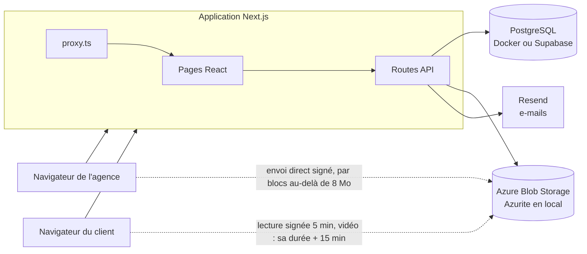

# Technologies de Kora

Ce document récapitule les technologies utilisées par Kora (nom de code ScopeGuard), leur rôle et la raison de leur choix. Il complète [README.md](README.md), qui explique comment lancer le projet, et [AZURE_PRODUCTION_TRAJECTORY.md](AZURE_PRODUCTION_TRAJECTORY.md), qui décrit la cible de production.

État au 23 octobre 2026.

## Vue d'ensemble

Une seule application Next.js porte l'interface et le serveur. Le navigateur ne parle jamais directement à la base. Il ne touche au stockage qu'avec une adresse signée par le serveur, courte et limitée à un fichier : lecture après vérification des droits, ou création d'un fichier que le serveur relit ensuite. Tout le reste passe par les routes API, qui vérifient l'identité et les droits.

## Les technologies, couche par couche

### Interface

| Technologie | Version | Rôle |
| --- | --- | --- |
| **Next.js** (App Router, Turbopack) | 16.3.8 | Cadre de l'application : pages, routes API, compilation. Version exacte figée. |
| **React** | 19.2.8 | Interface. |
| **TypeScript** | 5.9 | Typage de tout le code, interface comme serveur. |
| **Tailwind CSS** | 4.3 | Styles utilitaires, reliés aux jetons du design system Kora (`src/theme/tokens.css`). |
| **shadcn/ui** et **Radix UI** | 4.21 / 1.8 | Composants accessibles : fenêtres, menus, onglets, infobulles. |
| **lucide-react** | 1.56 | Icônes. |
| **sonner** | 2.0 | Notifications à l'écran. |
| **react-pdf** et **pdf.js** | 11.0 / 6.3 | Affichage des PDF. pdf.js est chargé dans sa version « legacy » (`next.config.ts`) : la version moderne exige des navigateurs très récents. |
| **react-zoom-pan-pinch** | 4.2 | Zoom et déplacement sur le plan de travail. |
| **input-otp** | 1.5 | Le champ du code à 6 chiffres, en six cases (accès client, confirmation). |
| **Inter, Manrope, IBM Plex Mono** | `next/font` | Polices de l'interface, du titrage et du code, servies par l'application elle-même (`src/app/layout.tsx`, `src/theme/tokens.css`). |
| **modern-screenshot** | 4.7.0 (exacte) | Capture de la fenêtre quand une demande est posée sur le site de recette. Sa version navigateur est copiée dans `public/vendor/modern-screenshot-4.7.0.js` et chargée par la barre au premier clic seulement ; un test vérifie que la copie est celle du paquet installé. Choisie pour sa légèreté (29 Ko, aucune dépendance) et parce que le navigateur dessine lui-même la page (CSS moderne fidèle). |

### Serveur et données

| Technologie | Version | Rôle |
| --- | --- | --- |
| **Routes API Next.js** | — | Le back-end : `src/app/api/`. Pas de serveur séparé. |
| **PostgreSQL** | 17 | Base de données. Docker en local, Supabase (Francfort) en ligne, Azure Database for PostgreSQL à terme. Choisie pour les relations entre les données, les transactions et la sécurité par ligne. |
| **Drizzle ORM** et **drizzle-kit** | 0.45 / 0.31 | Accès à la base en TypeScript, schéma (`src/db/schema.ts`) et migrations versionnées (`drizzle/`). |
| **node-postgres** (`pg`) | 8.23 | Pilote PostgreSQL. |

### Authentification

| Technologie | Version | Rôle |
| --- | --- | --- |
| **Better Auth** | 1.7.10 | Comptes de l'agence : e-mail et mot de passe (haché en scrypt ; 12 caractères au moins, variés, rien de courant ni de personnel, `src/lib/passwordPolicy.ts`), Google et Microsoft en option (adresse confirmée exigée pour accepter une invitation, et pour Microsoft quand il ne la garantit pas), réinitialisation, limitation des tentatives. Module « organization » pour les agences, les membres, les rôles et les invitations. Les données restent dans notre base. |
| **Accès client maison** | — | Les clients n'ont pas de compte : lien personnel, code à 6 chiffres par e-mail, appareil reconnu 30 jours (`src/db/reviewAuth.ts`). |

### Fichiers

| Technologie | Version | Rôle |
| --- | --- | --- |
| **Azure Blob Storage** | SDK 12.34 | Fichiers importés : un conteneur privé par agence, rangé par projet, livrable et version, fichiers nommés par leur empreinte SHA-256 (`src/lib/storage.ts`). Lecture par adresse signée valable 5 minutes (`FILE_LINK_SECONDS`) ; pour une vidéo, sa durée plus 15 minutes (durée plafonnée à 3 heures), et le lecteur en redemande une si elle expire. Import envoyé directement par le navigateur avec une adresse de création seule (15 minutes, plus pour un gros fichier ; création et écriture pour un fichier envoyé en blocs), puis verrouillé par un bail Azure permanent, relu et vérifié par le serveur : plus aucune adresse ne peut le remplacer (`src/lib/upload.ts`, `completeUpload`). Empreinte calculée dans le navigateur par morceaux avec `@noble/hashes`, déjà dépendance de Better Auth (pas de WebAssembly : la politique de sécurité des pages le ferme). |
| **Azurite** | 3.35 | Émulateur officiel d'Azure Storage, dans Docker, pour le développement et les tests. |

### E-mails

| Technologie | Rôle |
| --- | --- |
| **Resend** (API HTTP) | Invitations, codes d'accès, relances, réinitialisations, devis envoyés, décisions du client et demandes de démo. Domaine `gmmforge.com` vérifié (SPF, DKIM, DMARC). Chaque e-mail part en HTML et en texte, avec « Répondre à » vers le membre de l'agence concerné (`src/lib/mail.ts`, `src/lib/mailTemplates.ts`). |

### IA

| Technologie | Rôle |
| --- | --- |
| **Claude** (API Messages d'Anthropic, Haiku 5.5 par défaut) | Suggestion de qualification d'une demande par rapport au périmètre vendu (US-045, `src/lib/ai/`) : décision, ligne du devis citée, une phrase de raison, que l'agence confirme toujours. Un simple appel HTTP, sans SDK ; la réponse est imposée par un outil au schéma fixé, puis vérifiée. Choisi par `AI_PROVIDER` : un autre fournisseur (Claude ou OpenAI sur Azure) s'ajoute sans rien réécrire. Sans réglage, Kora ne suggère rien. Les données partent chez Anthropic (États-Unis par défaut) : à mentionner aux agences (registre des traitements). |

### Figma

| Technologie | Rôle |
| --- | --- |
| **API web de Figma** (OAuth 2 avec PKCE, appels HTTP sans SDK) | Commentaires des fichiers Figma qualifiés dans Kora (US-054, `src/lib/figma.ts`). Faits : la connexion d'une agence à son compte Figma, clés scellées en base (AES-256-GCM, `src/lib/sealed.ts`) et renouvelées avant expiration ; le livrable « Figma » (fichier, pages en revue, version enregistrée dans Figma). Un plugin Figma ne peut pas lire les commentaires : seule cette API le peut. |

### Tests et qualité

| Technologie | Version | Rôle |
| --- | --- | --- |
| **Playwright Test** | 1.63 | 186 tests de bout en bout (`tests/e2e/`, `npm run test:e2e`, environ 2 min 30 à 3 min) : l'application compilée pour la production, une base de test recréée à chaque lancement, Azurite, e-mails écrits dans un fichier, un faux serveur Figma (`tests/e2e/figmaStandIn.ts`) ; 4 fichiers de test à la fois, les tests d'un fichier à la suite. Couvre la connexion, les agences et leurs rôles, chaque geste de l'agence et du client dans l'interface et par l'API (refus compris), l'accès client et ses rôles, les fichiers, la preuve, les relances et les notifications. |
| **ESLint** | 9.39 | Analyse du code, avec la configuration de Next.js. |
| **Prettier** | 3.9 | Mise en forme. |

### Outils de développement

| Outil | Rôle |
| --- | --- |
| **Docker Compose** | PostgreSQL et Azurite en local (`npm run db:up`). |
| **Agentation** | Annotation de l'interface pour les agents IA, en développement seulement. |
| **Node.js** | 22 LTS. |

### Hébergement

| Service | Usage |
| --- | --- |
| **Vercel** | Déploiement actuel (prévisualisations et pilotes). Fonctions à Francfort (`fra1`, fixé dans `vercel.json`), à côté de Supabase : chaque requête à la base ne fait qu'un aller-retour court. |
| **Supabase** | PostgreSQL en ligne. Seule la base est utilisée : ni son API REST (fermée par la sécurité par ligne), ni son authentification, ni son stockage. |
| **Azure** | Stockage des fichiers aujourd'hui ; cible de production pour l'application et la base (voir la trajectoire Azure). |

## Environnements

Chaque service se choisit par une variable, de la même façon :

| Variable | `local` | `remote` |
| --- | --- | --- |
| `DATABASE_TARGET` | PostgreSQL dans Docker | Supabase, puis Azure |
| `STORAGE_TARGET` | Azurite dans Docker | Compte Azure Storage |

Les e-mails partent par Resend dès que `RESEND_API_KEY` et `MAIL_FROM` sont renseignées. `MAIL_TRANSPORT=console` les affiche dans la console sans jamais les envoyer, quoi qu'il arrive : c'est le mode des tests. La liste complète des variables est dans [.env.example](.env.example). Les secrets ne sont jamais commités : `.env.local` en local, les variables d'environnement de Vercel en ligne.

## Organisation du code

| Dossier | Contenu |
| --- | --- |
| `src/app/(agency)/` | L'espace agence (l'application principale, l'éditeur, la barre latérale, l'équipe). |
| `src/app/review/[token]/` | La page de revue du client et son écran de vérification. |
| `src/app/decouvrir/` | La page d'accueil publique (ce qu'un visiteur voit à `/` ; un membre y voit l'application). Ses illustrations sont l'interface de Kora redessinée en HTML (`Mockups.tsx`), pas des images. |
| `src/app/demo/` | La page « Réserver une démo » : le formulaire envoie `POST /api/demo`, transmis par e-mail à `DEMO_REQUESTS_TO`. |
| `src/app/connexion`, `commencer`, `bienvenue`, `demarrer`, `invitation`, `reinitialiser` | Connexion, création du compte depuis la page d'accueil, création de l'agence, premier espace, projet et collègues, invitation d'un collègue, nouveau mot de passe. |
| `src/app/review/[token]/site/`, `src/app/review/site/[key]/` | Le panneau Kora sur le site de recette, ouvert par la barre (`public/kora-toolbar.js`) avec le jeton d'une version ou la clé fixe du livrable. |
| `src/app/api/` | Les routes API. |
| `src/db/` | Schéma, lecture de l'état (`state.ts`), actions de l'agence (`agencyActions.ts`, `workspaceActions.ts`) et du client (`reviewActions.ts`, règles dans `reviewAccess.ts`), accès client (`reviewAuth.ts`), droits (`agencyPermissions.ts`), preuve (`proof.ts`). |
| `src/app/(agency)/editor/` | Le canevas partagé par l'agence et le client (`ReviewCanvas.tsx`), ses fils et épingles (`CanvasComments.tsx`), le panneau des demandes (`EditorInspector.tsx`), la barre vidéo (`VideoBar.tsx`), le tableau « Lien » (`SiteBoard.tsx`), le tableau « Figma » (`FigmaBoard.tsx`), la comparaison de versions (`VersionCompare.tsx`). |
| `src/lib/` | Authentification, sessions, stockage, e-mails, rôles client (`clientRoles.ts`), lecture de l'état et envoi des actions côté navigateur (`stateSync.ts`, `actionRequest.ts`), envoi des fichiers (`upload.ts`), vidéo (`timecode.ts`, `videoCheck.ts`), suggestion IA (`ai/`). |
| `src/proxy.ts` | Sans session : `/` montre la page d'accueil publique, le reste redirige vers `/connexion` (l'ancien « middleware » de Next.js). |
| `drizzle/` | Migrations SQL, à appliquer avant chaque déploiement qui en ajoute. |
| `tests/e2e/` | La suite de tests. |

## La sécurité, en bref

- **Isolation des agences** : chaque enregistrement porte l'identifiant de son agence dans sa clé primaire, et le serveur filtre chaque requête dessus.
- **Rôles** : les décisions commerciales et irréversibles sont réservées aux administrateurs, et le serveur les refuse aux membres (`src/db/agencyPermissions.ts`).
- **Clients** : ils n'accèdent qu'à la version partagée avec eux, sans voir qui d'autre est invité. Seuls les décideurs désignés par l'agence prennent les décisions (devis, validation) ; les contributeurs commentent. Ils écrivent une action à la fois, que le serveur construit depuis la base : leurs propres commentaires, leurs décisions et la validation. Le serveur signe ce qu'ils écrivent avec leur nom et leur adresse vérifiée (`src/db/reviewActions.ts`, `src/db/reviewAccess.ts`).
- **Journal d'audit** : il est en ajout seul, et un trigger PostgreSQL refuse toute modification ou suppression. Chaque événement garde l'heure du serveur, l'identité constatée, l'IP et le navigateur. Il alimente la preuve de validation (`src/db/proof.ts`).
- **Base** : la sécurité par ligne est activée sur toutes les tables, ce qui ferme l'API publique de Supabase.
- **Fichiers** : les conteneurs sont privés, l'accès est vérifié avant chaque lecture, et l'adresse signée n'est valable que 5 minutes (une vidéo : sa durée plus 15 minutes, plafonnée). Une adresse d'import ne permet que de créer un fichier (et d'écrire ses blocs pour un gros fichier), jamais de le lire ; le serveur verrouille le fichier reçu par un bail permanent, recalcule son empreinte et supprime tout fichier non conforme : un fichier enregistré ne peut plus être remplacé.
- **Adresses IP** : seule l'adresse ajoutée par un proxy de confiance est retenue (`TRUSTED_PROXY_HOPS`). Sinon, elle est marquée « non vérifiée ».
- **En-têtes HTTP** (`next.config.ts`, `src/lib/securityHeaders.ts`) : politique de sécurité du contenu en production (scripts et connexions limités au site et au stockage, pas de plugin, `frame-ancestors 'none'`), `X-Frame-Options: DENY`, `nosniff`, `Referrer-Policy`, `Permissions-Policy`, HSTS en HTTPS. Next.js ne s'annonce plus. Les scripts gardent `'unsafe-inline'` : une politique à nonces rendrait toutes les pages dynamiques.
- **Requêtes d'un autre site** : toute écriture dont l'origine n'est pas le site est refusée (`src/proxy.ts`, `crossSiteWrite`), en plus des cookies `SameSite=Lax`.
- **Panneau sur le site de recette** (US-048) : la seule page que Kora laisse afficher dans un cadre, `/review/:token/site`, et seulement par le site du livrable (`frame-ancestors` posé par `src/proxy.ts`, origine vérifiée par la page). Ses sessions (client, agence) sont des cookies partitionnés, propres à ce site ; celle de l'agence vient d'un ticket signé remis par une fenêtre Kora, et n'ouvre que commenter, répondre et qualifier sur la version du lien. Une demande n'y nomme qu'une capture envoyée par son auteur (image JPEG ou PNG reconnue à ses octets, `src/lib/siteCapture.ts`) : jamais un autre fichier de l'agence. Le script du site et le panneau vérifient l'origine et la fenêtre de chaque message, et le site ne reçoit jamais le texte des demandes.
- **Limites de débit** (`src/db/requestLimits.ts`), comptées en base : imports par heure, enregistrements par minute, invitations par heure, demandes de code d'accès par heure et par adresse IP, demandes de démo par heure, toutes réglables par variable d'environnement. Elles s'ajoutent aux limites de connexion (Better Auth) et des codes client.
- **Connexions à d'autres services** (Figma, US-054) : leurs clés sont scellées en base (AES-256-GCM, `TOKEN_ENCRYPTION_KEY`, distincte du secret de connexion) et jamais envoyées à une page. Une connexion OAuth n'est enregistrée que pour la tentative lancée par ce membre, dans ce navigateur (`state` signé, cookie, PKCE), et par le propriétaire ou un administrateur.
- **Adresses `/api` inconnues** : elles répondent `404 { error }` (`src/app/api/[...unknown]/route.ts`) au lieu de retomber sur les pages.

## Points d'attention

- **Synchronisation d'état** : les pages lisent l'état par `/api/state` (agence) et `/api/review/:token` (client), en une seule requête SQL (`readState`), et le relisent toutes les 2 secondes ; chaque action renvoie l'état à jour dans sa réponse. Elles ne l'écrivent jamais : chaque écriture a sa route par action (`src/db/agencyActions.ts`, `workspaceActions.ts`, `reviewActions.ts`), que le panneau du site de recette emprunte aussi.
- **Imports abandonnés** : un fichier envoyé au stockage sans validation y reste (aucun enregistrement ne le sert). Azure efface de lui-même, au bout d'une semaine, les blocs d'un envoi jamais assemblé ; un fichier assemblé mais jamais validé reste. Un nettoyage périodique est à prévoir, plus utile depuis les vidéos d'un Go.
- **Fichiers antérieurs au stockage Azure** : la table `files` est conservée, mais ses fichiers ne sont plus servis (Supabase n'en contient aucun).
- **`npm audit`** signale encore, en production, des paquets qui ne sont pas exploitables dans Kora : `drizzle-kit` et `esbuild` (tirés par Better Auth ; la faille d'esbuild concerne son serveur de développement), `source-map-js` (compilation CSS) et `sharp` (optimisation d'images de Next, désactivée par `images.unoptimized`). À revoir à chaque mise à jour de ces dépendances.
- **Dette** : `src/app/(agency)/AgencyApp.tsx` fait près de 2 850 lignes (à découper au fil des évolutions de l'éditeur), et 19 erreurs ESLint anciennes restent à traiter (`AgencyApp.tsx`, `BrowserView.tsx`, la page de revue du client).
- **Sauvegardes et suivi des erreurs** : à vérifier (offre Supabase) et à brancher (Sentry ou équivalent) avant d'élargir les pilotes.

## Commandes utiles

| Commande | Effet |
| --- | --- |
| `npm run db:up` | Démarre PostgreSQL et Azurite. |
| `npm run db:migrate` | Applique les migrations sur la base choisie (`DATABASE_TARGET`). |
| `npm run db:generate` | Crée une migration après une modification du schéma. |
| `npm run dev` | Lance l'application en développement. |
| `npm run test:e2e` | Lance la suite de tests (Docker doit tourner). |
| `npm run build` | Compile l'application pour la production. |
